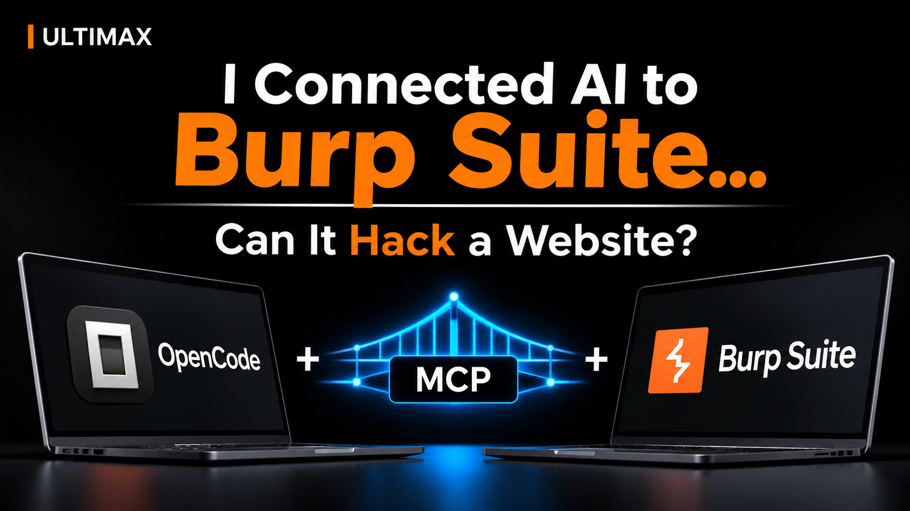

# OpenCode + Burp Suite MCP



Connect [OpenCode](https://opencode.ai/) to [Burp Suite](https://portswigger.net/burp) through the Model Context Protocol (MCP).

This setup allows OpenCode to communicate with a Burp Suite MCP server running locally on your machine.

## Configuration

Add this to your OpenCode configuration file:

```json
{
  "$schema": "https://opencode.ai/config.json",
  "mcp": {
    "servers": {
      "burp": {
        "type": "remote",
        "url": "http://127.0.0.1:9876/mcp",
        "oauth": false,
        "disabled": false
      }
    }
  }
}
```

The configuration expects the Burp Suite MCP server to be available at `http://127.0.0.1:9876/mcp`. Start and configure the MCP server in Burp Suite before connecting OpenCode.

## Files

- `opencode.json` — OpenCode MCP configuration.
- `.gitignore` — Ignores common local and secret files.
- `LICENSE` — MIT License.

## Safety

Use Burp Suite and its tools only on applications you own or have explicit permission to test. Review tool actions before running them, and avoid sending sensitive data to AI services.

## Video

Watch ULTIMAX on YouTube: [@ultimax-hacks](https://www.youtube.com/@ultimax-hacks)

## Credits

Created by **ULTIMAX** — exploring AI, cybersecurity, ethical hacking, and technology.
